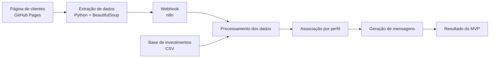
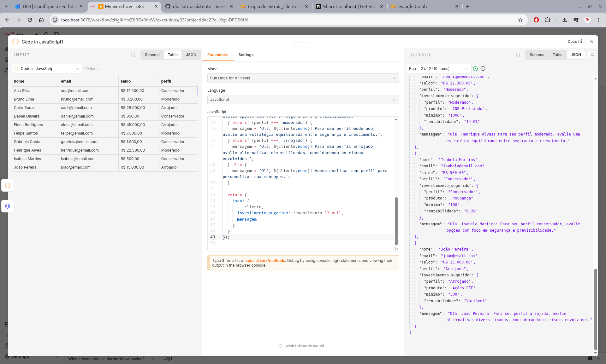

# Criando um Assistente de Investimentos com RPA e IA Generativa

## Descrição

Este projeto demonstra, na prática, como combinar RPA (Robotic Process Automation), Python e workflows no n8n para automatizar o processamento de dados de clientes e gerar mensagens personalizadas de acordo com seus perfis de investidores.

O fluxo utiliza Python para extrair dados de uma página web, envia essas informações para um Webhook do n8n, cruza os perfis dos clientes com uma base de opções de investimento e gera mensagens personalizadas usando regras estáticas.

O projeto foi desenvolvido como parte do desafio prático da DIO, com foco no aprendizado de automação e integração entre sistemas.

## Objetivo do projeto

Desenvolver um pipeline de automação capaz de:

1. Coletar dados de clientes de uma página web usando Python.
2. Enviar os dados extraídos para um Webhook do n8n.
3. Consultar uma base de opções de investimento.
4. Relacionar cada cliente à opção correspondente ao seu perfil.
5. Gerar mensagens personalizadas de acordo com o perfil do investidor.

## Arquitetura do projeto



## Tecnologias e ferramentas

| Tecnologia | Função |
|---|---|
| Python | Extração e envio dos dados dos clientes |
| Requests | Requisições HTTP e envio via POST |
| BeautifulSoup | Leitura e extração dos dados da página HTML |
| n8n | Orquestração do workflow de automação |
| Webhook | Recebimento dos dados enviados pelo Python |
| CSV | Base de opções de investimento |
| GitHub | Versionamento, armazenamento e documentação do projeto |
| Google Colab | Execução do código Python durante os testes |

## Fontes de dados

**Página de clientes:**

https://digitalinnovationone.github.io/dio-lab-assistente-investimentos-rpa-n8n/

**Base de investimentos:**

https://raw.githubusercontent.com/digitalinnovationone/dio-lab-assistente-investimentos-rpa-n8n/main/docs/data.csv

Os dados utilizados no projeto são destinados à demonstração e ao aprendizado. As mensagens geradas não constituem recomendação financeira individualizada.

## Como funciona a automação

### 1. Extração dos clientes

O script Python acessa a página de clientes com a biblioteca `requests` e utiliza o `BeautifulSoup` para localizar as linhas da tabela HTML.

Os dados extraídos são organizados em uma lista de registros com os seguintes campos:

- `nome`
- `email`
- `saldo`
- `perfil`

### 2. Envio ao Webhook do n8n

Após a extração, o Python envia a lista de clientes em formato JSON por meio de uma requisição HTTP POST.

O endereço do Webhook deve corresponder à URL disponibilizada pelo n8n. No ambiente utilizado durante os testes, foi empregado um túnel ngrok, cujo endereço é temporário.

**Importante:** para novas execuções, verifique se o n8n está ativo, se o Webhook está configurado corretamente e se a URL utilizada continua válida.

### 3. Processamento no n8n

O workflow recebe os dados dos clientes e processa os registros. Em seguida, consulta a base de investimentos, relaciona as opções disponíveis ao perfil de cada cliente e prepara os resultados.

### 4. Associação do perfil ao investimento

O fluxo utiliza o perfil do investidor para selecionar uma opção de investimento correspondente na base de dados.

Os perfis considerados são:

- **Conservador:** perfil associado a alternativas de menor risco.
- **Moderado:** perfil associado a alternativas de risco intermediário.
- **Arrojado:** perfil associado a alternativas de maior exposição à renda variável.

A associação depende dos dados presentes na base de investimentos utilizada pelo workflow.

### 5. Geração das mensagens

Na versão MVP, as mensagens são geradas por templates e regras estáticas no n8n, sem depender de um modelo de IA generativa.

Cada registro processado pode conter os dados do cliente, o investimento sugerido e a mensagem correspondente ao perfil.

## Resultado da implementação do MVP

Durante o teste realizado, o fluxo processou **10 registros de clientes** e gerou os campos `investimento_sugerido` e `mensagem` para os resultados.

As etapas demonstradas foram:

1. Extração e organização dos dados dos clientes.
2. Envio dos dados ao Webhook.
3. Consulta à base de opções de investimento.
4. Associação dos clientes às opções conforme seus perfis.
5. Geração das mensagens personalizadas.

### Evidência da execução

A captura abaixo registra a execução utilizada como evidência do MVP.



## Entregáveis

### MVP — Mínimo Viável

- [x] Repositório forkado e organizado no GitHub.
- [x] Workflow do n8n exportado em `n8n/workflow.json`.
- [x] Script Python com extração dos dados e envio ao Webhook.
- [x] Evidência visual da execução do fluxo.
- [x] Documentação do projeto e dos resultados obtidos.

### Desafio avançado — IA generativa

As etapas abaixo representam possíveis evoluções do projeto e não fazem parte do MVP documentado acima:

- [ ] Integração com um agente de IA no n8n.
- [ ] Geração dinâmica de mensagens por meio de um modelo de linguagem (LLM).
- [ ] Documentação das decisões técnicas específicas da integração com IA.

## Estrutura do repositório

```text
dio-lab-assistente-investimentos-rpa-n8n/
├── README.md
├── docs/
│   ├── index.html
│   └── data.csv
├── n8n/
│   └── workflow.json
├── rpa/
│   ├── extrair_clientes.ipynb
│   └── cópia_de_extrair_clientes.py
└── evidencia-mvp-n8n.png
```

**Observação:** a estrutura acima representa os arquivos identificados no repositório durante a documentação. O notebook original e a cópia Python podem ter conteúdos ou finalidades diferentes; consulte cada arquivo para verificar sua versão.

## Como executar

### Python

Instale as dependências necessárias:

```bash
pip install requests beautifulsoup4
```

Abra o script localizado em `rpa/cópia_de_extrair_clientes.py` e confira a URL da página e a URL do Webhook antes de executar.

A URL do Webhook deve ser atualizada conforme o ambiente n8n utilizado. Endereços temporários do ngrok não devem ser tratados como URLs permanentes.

### n8n

1. Abra sua instância do n8n.
2. Importe o arquivo `n8n/workflow.json`.
3. Confira as configurações dos nós e as URLs utilizadas.
4. Ative ou execute o Webhook conforme o modo de teste ou produção escolhido.
5. Execute o script Python com o endpoint correspondente.
6. Confira a execução e os resultados no n8n.

## Limitações e melhorias futuras

O MVP utiliza mensagens estáticas e depende da disponibilidade da página de origem, da base CSV e do endpoint do Webhook.

Como melhorias futuras, o projeto pode receber:

- Integração com um modelo de IA generativa.
- Validação e tratamento mais completos dos dados extraídos.
- Configuração do endpoint por variável de ambiente.
- Registro de erros e histórico das execuções.
- Execução agendada e monitoramento do workflow.

## Referências

- [Documentação oficial do n8n](https://docs.n8n.io/)
- [Beautiful Soup — documentação](https://www.crummy.com/software/BeautifulSoup/bs4/doc/)
- [GitHub Pages](https://pages.github.com/)
- [Repositório original do desafio DIO](https://github.com/digitalinnovationone/dio-lab-assistente-investimentos-rpa-n8n)

---

**Projeto desenvolvido para fins educacionais, como prática de RPA, Python, integração via Webhook e automação de workflows com n8n.**
